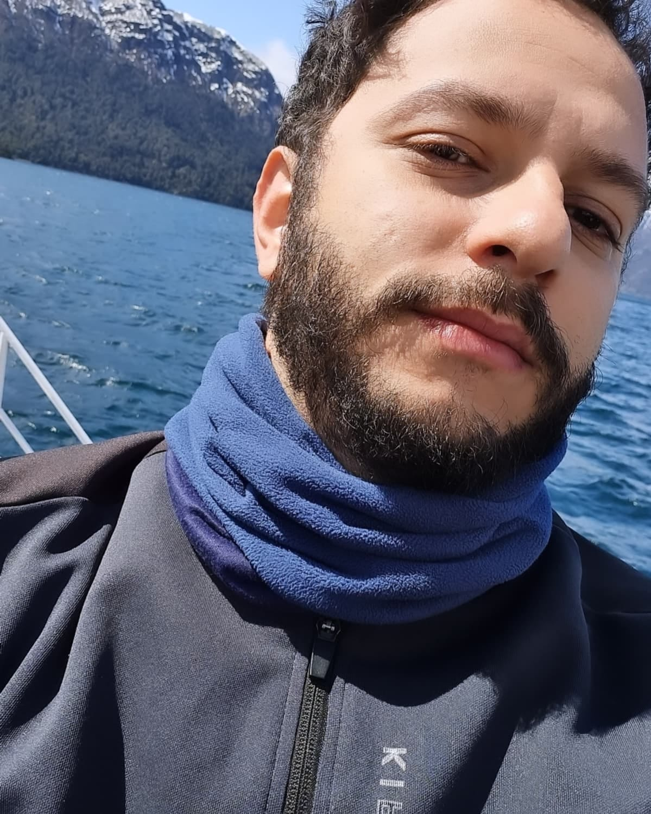

Aníbal Cantalice

Cientista · Professor

<h3>Formação</h3>

<i class="bi bi-mortarboard-fill"></i>

Doutorado em Etnobiologia e Conservação da Natureza
· 2025

Universidade Federal Rural de Pernambuco (UFRPE)

<i class="bi bi-mortarboard-fill"></i>

Mestrado em Desenvolvimento e Meio Ambiente
· 2021

Universidade Federal do Piauí (UFPI)

<i class="bi bi-mortarboard-fill"></i>

Licenciatura em Ciências Biológicas
· 2017

Universidade Federal do Piauí (UFPI)

## Sobre mim

Minha trajetória acadêmica começou com uma curiosidade simples. Entender como as pessoas percebem, utilizam e transformam o ambiente ao seu redor. A Etnobiologia se tornou o espaço onde encontrei muitas dessas perguntas e, mais recentemente, tenho buscado explorá-las em escalas mais amplas — para além das comunidades locais — por meio da macroetnobiologia.

No caminho, acabei desenvolvendo outras duas paixões: analisar dados e programar. Gosto especialmente de pensar em como a programação pode tornar as análises mais eficientes, reproduzíveis e claras, e a linguagem R acabou se tornando uma das minhas principais ferramentas nesse processo. Também tenho experiência com estatística inferencial, modelagem estatística e análise e visualização de dados tabulares e geoespaciais.

Entre trabalho de campo, código, modelos, mapas e algumas horas tentando descobrir por que um <em>script</em> resolveu se rebelar, é nessa mistura de pessoas, ambiente, programação, estatística e dados que tenho construído minha trajetória científica.

## Interesses de pesquisa

Conservação

Ecologia Númerica

Etnobiologia

Macroetnobiologia

Sistemas socioecológicos

## Competências

<h3>Hard Skills</h3>

Etnobiologia e Etnoecologia

Análise de dados em R

Modelagem estatística

Métodos de pesquisa de campo

Análise espacial e SIG

Escrita científica

<h3>Soft Skills</h3>

Pensamento crítico

Pensamento analítico

Comunicação científica

Colaboração interdisciplinar

Liderança científica

Gestão de projetos

nível desenvolvido

a desenvolver

## Currículo

Uma versão completa da minha trajetória acadêmica e profissional está disponível no currículo abaixo.

<a class="cv-button" href="cv/cv.pdf">

<i class="bi bi-file-earmark-pdf"></i>

Baixar CV (PDF)

</a>

